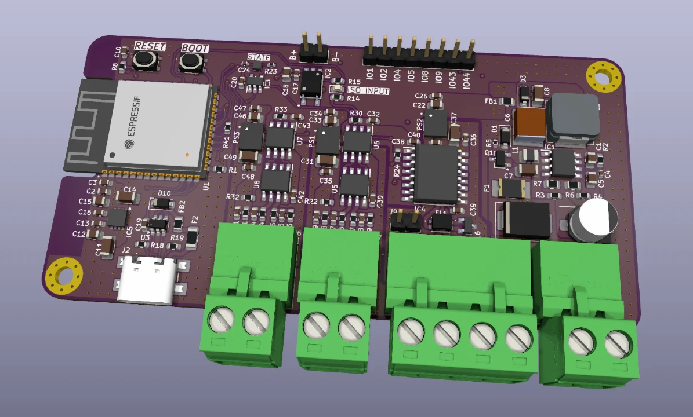
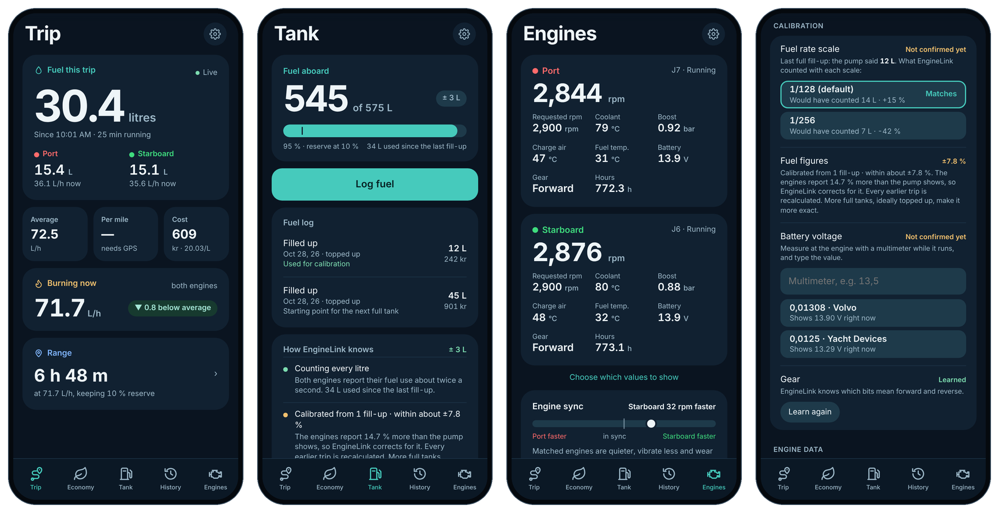

<p align="center">
  
</p>

<h1 align="center">EngineLink</h1>

<p align="center">
  Dual-engine marine fuel monitoring on a custom ESP32-S3 board. It reads two engines over J1708, either Volvo Penta KAD / EDC I or SAE J1587. It shows live fuel flow on your phone and records every engine run, without an app, internet or cloud.
</p>

<p align="center">
  
  
  
  
  
</p>

<p align="center">
  <a href="https://kaelor9.github.io/EngineLink/demo/">
    
  </a>
  <a href="https://kaelor9.github.io/EngineLink/">
    
  </a>
</p>

<p align="center">
  <a href="https://kaelor9.github.io/EngineLink/demo/">
    
  </a>
  <br>
  <sub>The phone app served by the board. <a href="https://kaelor9.github.io/EngineLink/demo/">Open the live demo</a> to use it in your browser against a simulated boat.</sub>
</p>

---

> [!WARNING]
> **Current engineering blocker (2026-10-31, firmware v0.11.4):** The ESP32-S3 can associate with a Zyxel EX3600-T0 using **WPA3-SAE** and obtain a DHCP address, but the web UI and HTTP endpoints are intermittently extremely slow or inaccessible over the router. `enginelink.local` sometimes gives Chrome `DNS_PROBE_FINISHED_NO_INTERNET`, while the device still reports an active Wi-Fi connection. The independent 32 KiB download test has also failed in router mode. **Wi-Fi association is not proof that the product is reachable.** See [Current blocker / developer handover](#current-blocker--developer-handover-wi-fi-router-mode) before working on the next firmware revision.

---

## About

**EngineLink** is a dedicated onboard device for boats with two engines. It reads fuel and engine data from two separate J1708 engine interfaces, processes it locally and serves a clean web app straight from the device.

The goal is **useful and trustworthy fuel consumption** rather than raw frames on a screen. If the engines do not send a value, or it is stale or invalid, EngineLink shows **—** and explains why. It never shows a made-up 0.

It is developed for a Fairline Targa 34 with 2 × **Volvo Penta KAD300 (EDC I)**. These engines use Volvo's request/response protocol. Scalings come from the owner's VODIA analysis. See [docs/KAD300_EDC1.md](docs/KAD300_EDC1.md).

---

## Why EngineLink?

Marine engine displays rarely show combined consumption, economy per nautical mile or a history you can export. Generic ESP32 boards need extra isolation and protection before they can be connected to an engine bus.

EngineLink combines both on one board:

- Two **galvanically isolated** J1708 transceivers, one per engine
- An isolated NMEA 2000 interface for GPS speed and time
- microSD storage for raw data, engine runs and calibration captures
- Its own Wi-Fi network, so it works with no router and no internet
- A phone-friendly web app stored on the device

---

## Key Features

- 📱 **Phone app "Engine Link":** Trip, Economy, Tank, History and Engines, add it to the home screen. Light, dark and night themes, metric or imperial, any currency
- ⛽ **Live fuel flow:** per engine and combined L/h (KAD index 289 or J1587 PID 183)
- 🛥 **Automatic trips** with notes (people, sea, wind), combine/split and CSV export
- 🛢 **Fuel log and tank:** fuel aboard with an honest ±, range at the current speed
- 🎯 **Self-calibrating fuel figures:** weighted fit over all fill-ups (topped up / clicked off), separate correction for idle, part load and cruise, odd fill-ups caught, every trip recalculated
- 📊 **Economy:** best cruising speed, trip planner, season statistics per RPM band, engine health trend
- 🔧 **Volvo Penta KAD / EDC I:** VODIA scaling, passive decoding of an EDC display, or opt-in read-only polling
- ⚖️ **Calibration tools:** voltage check against a multimeter, fuel scale check, gear learned at the dock
- 🧹 **Checked engine data:** physical limits and jump confirmation on every answer, short gaps bridged, faster reading while the throttle moves
- 🧭 **Fuel economy:** L/nm when NMEA 2000 GPS speed is available
- 🧾 **Lifetime totals** with engine hours that survive restarts and recalculate after calibration
- 🔎 **Bus discovery:** every parameter your ECUs actually answer or send, with raw bytes
- 🧪 **Guided engine test:** record steady RPM stages with your own reference readings, export CSV
- 📶 **Two exclusive Wi-Fi modes:** EngineLink standalone AP at `192.168.4.1` / `enginelink.local` (factory default), or router-only STA at `enginelink.local`. Router failure restores the rescue AP after up to 120 seconds.
- 🔄 **Firmware updates from GitHub** over the boat router, with automatic rollback, or from a file
- 🩺 **Diagnostics** with a setup check, connection tests and calibration

---

## Hardware

| Feature | Specification |
|---------|---------------|
| MCU | ESP32-S3-WROOM-1-N8R8 |
| Flash / PSRAM | 8 MB / 8 MB (OPI) |
| Engine inputs | 2 × isolated J1708 (MAX3444E + ADuM1201), J7 and J6 |
| Marine network | Isolated NMEA 2000 (ISO1042), listen-only |
| Storage | microSD (SPI) with card detect |
| Status | SK6805 addressable LED, level-shifted |
| Digital input | Optoisolated input on GPIO38 |
| Wireless | Wi-Fi 2.4 GHz access point + optional router |
| USB | USB-C, native USB CDC |
| Power | Polyfuse + TVS (SMCJ33CA) + reverse protection → LM5164 buck → 5 V → 3.3 V LDO |

### Pinout

| Connection | ESP32-S3 | Notes |
|------------|----------|-------|
| J7 · J1708 channel 1 | RX GPIO21 · TX GPIO47 | TX only while KAD polling runs; solder jumper SJ1 |
| J6 · J1708 channel 2 | RX GPIO17 · TX GPIO18 | TX only while KAD polling runs; solder jumper SJ2 |
| NMEA 2000 CAN | TX GPIO15 · RX GPIO16 | Listen-only when enabled |
| microSD | CS 10 · MOSI 11 · SCK 12 · MISO 13 · Detect 14 | Detect LOW = inserted |
| Status LED | GPIO48 | SK6805 |
| Isolated input | GPIO38 | |
| I²C | SDA 8 · SCL 9 | Unused, no RTC fitted |

On the schematic, channel 1 (J7) sits on the isolated domain named ISO2 and channel 2 (J6) on ISO1. This is cosmetic only. More detail and safety checks: [docs/HARDWARE.md](docs/HARDWARE.md).

---

## Software

The firmware is written for the ESP32-S3 with the Arduino framework. The complete web app (HTML, CSS and JavaScript) is embedded in flash, so it works without any internet connection.

| Page | What it shows |
|------|---------------|
| **Trip** | Fuel this trip, burn now against your average, cost, L/nm and range |
| **Economy** | Best cruising speed, trip planner, season statistics, insights |
| **Tank** | Fuel aboard, fuel log, how the estimate is made |
| **History** | All trips with notes, combine/split, CSV export |
| **Engines** | Every value per engine, engine sync, health trend, service |
| **Settings** | Units, currency, EngineLink Wi-Fi and boat router, firmware, diagnostics, SD card, backup and reset |

The app source is [`firmware/ui/app.html`](firmware/ui/app.html); `tools/build_ui.py` packs it gzip-compressed into `firmware/EngineLink/ui.h`.

---

## Getting Started

1. **New boards only:** Open the **[web installer](https://kaelor9.github.io/EngineLink/)** in Chrome or Edge on a computer.
2. Connect the board with a USB-C data cable, tick the safety confirmation and click **Install**.
3. On your phone, join the Wi-Fi **EngineLink** (password `12345678`) and open **http://192.168.4.1**.
4. Complete the setup, then add **Engine Link** to the home screen (Settings shows how on iPhone and Android).
5. For Volvo Penta KAD300, follow the **[test procedure](docs/KAD300_EDC1.md#test-procedure-on-the-boat)**: listen, voltage check, RPM check, then tank to tank.

### Updating over Wi-Fi

You only need the cable once. For later versions:

- **With a boat router:** connect EngineLink to it under Settings → Boat router, then open **Settings → Firmware** and install the version you want. EngineLink downloads it from GitHub Releases. If the new version does not run properly for its first minute, EngineLink goes back to the previous one by itself.
- **Without a router:** download **`enginelink-update.bin`** from the [download page](https://kaelor9.github.io/EngineLink/#downloads), join the EngineLink Wi-Fi and choose the file under **Settings → Firmware**.

Settings, trips, the fuel log and fuel totals are kept with Wi-Fi application updates. **The full 8 MB USB installer overwrites NVS and LittleFS**, including stored data, even without a separate Erase Flash selection. If an existing board is locked out of Wi-Fi, use [USB recovery with backups](docs/USB_RECOVERY.md), not the full installer.

---

## Important Information

> [!IMPORTANT]
>
> EngineLink is **alpha firmware** and has not been validated on real engines yet.
>
> - Disconnect the engine networks and NMEA 2000 during first flashing and bring-up
> - Measure **both** isolated 5 V supplies against **their own** isolated grounds (4.75–5.25 V) before connecting an engine
> - EngineLink only listens by default. **Reading the engines** (KAD polling) is a deliberate step: close the connector's jumper (SJ1/SJ2) and switch it on in Settings → Diagnostics with a confirmation. "Read engines automatically" is off until you turn it on. Only the read request `01 43 21` can be sent.
> - The KAD request format is reconstructed from Volvo's PC tool, and the reply layout is not yet wire-verified. Do the voltage check first.
> - Do not poll while a Volvo diagnostic tool (VODIA) is connected
> - Change the factory Wi-Fi password `12345678` in Settings

See [KAD300 / EDC I](docs/KAD300_EDC1.md), [alpha status and safety](docs/PRODUCTION_ALPHA.md) and the [engine test procedure](docs/ENGINE_TEST.md).

---

## Current blocker / developer handover: Wi-Fi router mode

**For an engineer or AI coding agent taking over this project.** This section describes observed hardware behavior, not a confirmed root cause. **Latest field-tested build: v0.11.4 (2026-10-31). The router-mode usability issue remains OPEN.** Do not mark it fixed because GitHub Actions compiles or because the ESP32 says `WL_CONNECTED`.

### Required network behavior

- **Standalone:** ESP32-S3 runs its own EngineLink Wi-Fi as **AP-only**; dashboard is available at `http://192.168.4.1` without a router or internet. This is the factory default.
- **Router mode:** ESP32-S3 joins a user-selected **2.4 GHz** Wi-Fi as **STA-only**. It must **not** also expose the EngineLink SoftAP. The phone/computer reaches the dashboard through that router; `http://enginelink.local` is a convenience, but access by the assigned IP must work even if mDNS does not.
- **Recovery:** If joining/rejoining fails persistently (currently 120-second guard), restore the standalone AP and retain useful failure diagnostics. Do not strand users on an unreachable network or create reboot loops. Since v0.11.6 the standalone fallback looks for the saved router (asynchronous scan, AP stays on) after 2 min and then every 10 min, doubling after each failed return up to 2 h, and never while the app is in use on the AP.
- Support standard **WPA2-Personal and WPA3-SAE / WPA2-WPA3 transition mode**, without requiring users to downgrade their router security. Preserve the read-only-by-default J1708, CAN/NMEA 2000 and engine-monitoring behavior. Engine data collection must not be blocked by a slow browser.

### What has been measured on the real board

| Firmware / network | Verified behavior |
|---|---|
| v0.11.1, standalone | AP-only / local HTTP responsive; no router connection is expected in this mode. |
| v0.11.1–0.11.2, Zyxel EX3600-T0 in WPA2/WPA3 mixed mode | Repeated association/authentication failures (including codes **2, 15, 202**); one run fell back after 120 s with **zero** association/IP events. An earlier v0.11.1 run had **two** DHCP IP events but multiple disconnects. |
| v0.11.2, iPhone 2.4 GHz hotspot | Joined cleanly: association **786 ms**, DHCP **1,513 ms**, zero disconnects in the supplied sample. Shows the hardware can operate as an STA. |
| v0.11.2–v0.11.3, Zyxel switched to WPA2-PSK | Obtained IP in roughly **2 seconds** with strong signal. Browser-measured 32 KiB download was poor (around **6–23 kB/s**), compared with about **369 kB/s** measured in standalone after the v0.11.3 speed-test changes. These are short, non-controlled application-level tests, **not** RF throughput measurements. |
| v0.11.3, Zyxel restored to WPA2/WPA3 mixed mode | **WPA3-SAE successfully negotiated**; DHCP succeeded. Then one active connection ended with **reason 209 (SA Query timeout)** at uptime ~365 s, recovering association/IP after ~31–33 s; router-side browser speed about **17 kB/s**. |
| **v0.11.4, Zyxel WPA2/WPA3 mixed mode — latest** | After pre-connection failures **202, 2, 2** at uptime 1–9 s, it **associated at 10.4 s**, received router IP **192.168.1.57 at 11.5 s**, negotiated **WPA3-SAE**, and reported around **−44 dBm**. At uptime **256 s**, it recorded **zero post-IP drops**, **one HTTP listener rebind**, and **34 served HTTP requests**; nevertheless the browser intermittently failed to load `enginelink.local` (including `DNS_PROBE_FINISHED_NO_INTERNET`), sometimes showed an empty/delayed UI, and the download speed check showed **Failed**. The speed worker reported **0 bytes / 0 write calls**, meaning it did **not record a completed payload write**; this does not by itself prove a zero-throughput radio link. |

The board's green indicator and `associated=true`/`hasRouterIp=true` describe **Wi-Fi association + DHCP**, **not** successful TCP connections, page serving or browser name resolution. Code 202 does **not** by itself prove an incorrect password. Code 209 is a WPA3/PMF SA Query timeout; v0.11.4 schedules an earlier retry for this case, but that does not establish that the underlying timeout has been eliminated. `DNS_PROBE_FINISHED_NO_INTERNET` does **not** isolate the cause to mDNS, nor does it mean EngineLink itself needs internet to serve its page.

**v0.11.5 (untested on hardware):** the app now switches from `enginelink.local` to the board's router IP as soon as it is known, for every request including ports 81/82. In the reports above the browser always used `enginelink.local`, so per-request mDNS resolution is a strong candidate for the slow/blank pages, `DNS_PROBE_FINISHED_NO_INTERNET` and the 0-byte speed test. If the board is equally slow at its direct IP, this hypothesis is wrong and the steps below apply.

### Immediate diagnosis: isolate DNS, TCP/HTTP and browser rendering

Run these from **the same Windows computer connected to the Zyxel LAN** while the board says it is on the router (replace the example IP if DHCP assigns a new one):

```powershell
# Port-80 reachability without any .local name resolution
Test-NetConnection 192.168.1.57 -Port 80
curl.exe -v --max-time 8 http://192.168.1.57/api/health
curl.exe -v --max-time 8 http://192.168.1.57/api/network-health

# Check whether the extra independent HTTP listeners are reachable
Test-NetConnection 192.168.1.57 -Port 81
Test-NetConnection 192.168.1.57 -Port 82
curl.exe -v --max-time 8 http://192.168.1.57:81/api/live
curl.exe -v --max-time 18 -o NUL http://192.168.1.57:82/api/speedtest

# Compare only after direct-IP access has been established
curl.exe -v --max-time 8 http://enginelink.local/api/health
```

Interpretation:

- **Direct IP port 80 works quickly but `.local` does not:** focus on mDNS advertisement/resolution and router multicast behavior. Do not modify WPA3 settings to fix a name-resolution-only problem.
- **Direct IP port 80 also fails or stalls:** investigate listening socket lifecycle, TCP handshake, server task blocking, routing/client isolation, and router-side packet delivery. A valid DHCP lease and green status are insufficient.
- **`/api/health` works but `/` is blank or very slow:** inspect gzip UI response, content length/chunking/keep-alive, browser caching and JS/bootstrap/API calls separately.
- **Port 80 works but ports 81/82 fail:** inspect sidecar listener startup/rebinding, worker task health, port binding and browser port access; do **not** infer low RF throughput from a failed port-82 speed test.

Record for each case the client device/network, whether **IP** and **hostname** work, TCP connection time, HTTP response time, exact error, and `/api/network-report` before and after the event. If possible also check Zyxel client logs and reproduce using a second WPA3 router; no packet capture has yet established whether the issue is in firmware, AP, mDNS, socket handling or their interaction.

### Source files / suspected boundaries (review, do not assume guilt)

- [`firmware/EngineLink/EngineLink.ino`](firmware/EngineLink/EngineLink.ino): `onWiFi()`, `connectRouter()` (explicit SAE H2E/Hunting-and-Pecking + PMF), `applyNetwork()`, `serviceNetwork()`, `startNameService()`, `EngineLinkWebServer::handleClient()` / `rebindNetwork()`, `refreshWorkerListener()`, `speedHttpTask()`, `liveHttpTask()`, `initializeWeb()`. The main listener serves **80**, live sidecar **81**, and the 32 KiB speed test **82**.
- [`firmware/ui/app.html`](firmware/ui/app.html): `hostCandidates()`, `findHost()`, `get()`, `tick()`, `speedTest` — hostname fallback, timeouts, live requests, port-82 measurement and presentation. Regenerate the embedded `firmware/EngineLink/ui.h` via [`tools/build_ui.py`](tools/build_ui.py) when editing UI source.
- [`firmware/EngineLink/routerguard.h`](firmware/EngineLink/routerguard.h): router recovery timeout.
- [`tools/test_router_reliability_contract.py`](tools/test_router_reliability_contract.py) and [`tools/test_network_architecture.py`](tools/test_network_architecture.py): static regression checks. CI success is necessary, **not a WPA3 / network performance field test**.
- [v0.11.3](docs/releases/v0.11.3.md) and [v0.11.4](docs/releases/v0.11.4.md) release notes document previous changes. Verify assumptions against current implementation rather than layering on more reconnect workarounds.

### Suggested engineering order and acceptance criteria

1. **Establish an IP-only baseline and get reproducible HTTP timings** in STA mode before changing SAE/PMF or RF settings. Diagnose the failed port-82 test separately.
2. **Instrument the full request path** (TCP listener alive/accepts, request parsing, main-handler latency, worker status, bytes actually written, mDNS lifecycle) with bounded, password-free diagnostics; avoid expensive debug logging or blocking engine acquisition.
3. **Fix the verified root cause**, not just reduce reconnect delays. Keep WPA3/PMF security intact, keep router mode STA-only and standalone AP-only, and preserve fallback/OTA/engine safety.
4. **Verify on actual hardware:** standalone `192.168.4.1`; WPA2 and WPA3-SAE against Zyxel and ideally another router; direct-IP HTTP and `.local` where multicast supports it; ports 80/81/82; repeated reloads/speed tests; sustained operation (at least 30 minutes) and recovery after deliberate router interruption. Report measured delays and failures, not only association status.

**Handover warning:** The user should **not** have to change the router's security mode or maintain a special router configuration just to make EngineLink usable. Do not describe v0.11.4 as a completed Wi-Fi fix.

---

## Project Status

| Hardware | Firmware | Engine validation |
|----------|----------|-------------------|
| ✅ Revision 1 assembled | 🚧 0.11.6 | ⏳ Pending first KAD300 test |

| Area | Status |
|------|--------|
| J1708 UART bench loop | Tested: 36,000 frames / 30 min / no recorded errors |
| microSD read/write | Bench tested |
| Status LED | Bench tested |
| Firmware build | CI compiled on every change |
| Router Wi-Fi / WPA3 | **OPEN — WPA3 association/DHCP confirmed; HTTP reachability and speed intermittently fail on Zyxel EX3600-T0 in v0.11.4. See developer handover above.** |
| KAD300 scaling (VODIA, M_902) | Confirmed from the database, fuel ×1/128 confirmed three ways |
| KAD request/reply on the wire | Reconstructed, verify with the voltage check |
| Fuel factor on the boat | Pending tank-to-tank |
| NMEA 2000 bus | Not yet validated |

---

## Roadmap

### Firmware

- [x] Offline web app with first-time setup
- [x] Dual-channel J1708 capture and SD logging
- [x] Guided engine test and calibration capture
- [x] Trip / lifetime totals and engine hours
- [x] Automatic engine-run log
- [x] Bus discovery
- [x] Wi-Fi firmware updates, from GitHub with rollback
- [x] Phone app with trips, fuel log, economy and engine health
- [x] Exclusive AP or STA: standalone Wi-Fi or boat router, 120-second rescue AP fallback
- [ ] Validate reliable router-mode HTTP/mDNS/sidecar performance with WPA2 and WPA3 on real hardware
- [x] Volvo Penta KAD / EDC I decoding and opt-in polling
- [ ] KAD reply layout confirmed on the wire
- [ ] Fuel factor and corrections confirmed tank to tank
- [ ] NMEA 2000 output of engine and fuel data
- [ ] Settings authorization and unique device credentials

### Hardware

- [x] Revision 1 PCB
- [x] Isolated J1708 and NMEA 2000 interfaces
- [ ] Isolated supply verification on assembled boards
- [ ] NMEA 2000 isolated ground review (`GND_N2K_ISO`)
- [ ] Field test on board

---

## Repository Structure

```text
.
├── .github/workflows/     # CI compile, validation and Pages publishing
├── docs/                  # KAD300/EDC I, hardware, alpha status, engine test, releasing
│   └── images/
├── experiments/           # Earlier bench Lab sketches (not the application)
├── firmware/
│   └── EngineLink/        # Application firmware + embedded web UI (ui.h)
├── hardware/              # Hardware notes
├── site/                  # GitHub Pages installer
├── HANDOVER.md            # Product requirements and design decisions
└── README.md
```

### Building locally

Arduino IDE or `arduino-cli` with the ESP32 core and the **Adafruit NeoPixel** library:

```bash
arduino-cli compile \
  --fqbn "esp32:esp32:esp32s3:FlashSize=8M,PartitionScheme=default_8MB,PSRAM=opi,USBMode=hwcdc,CDCOnBoot=cdc" \
  firmware/EngineLink
```

The version is defined once as `EL_VERSION` in `firmware/EngineLink/EngineLink.ino`. The installer and manifests take it from there. See [docs/RELEASING.md](docs/RELEASING.md).

---

## License

Licensing has not been selected yet. **Do not assume this repository is open source just because the code is visible on GitHub.**

---

<p align="center">
  Designed and developed by <strong>Kaelor9</strong>
  <br>
  ESP32-S3 • Marine Electronics • Dual-Engine Fuel Monitoring
</p>
